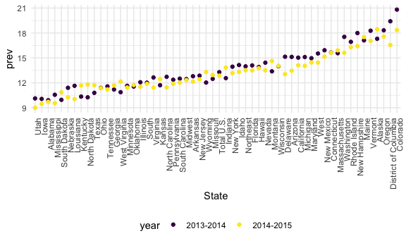
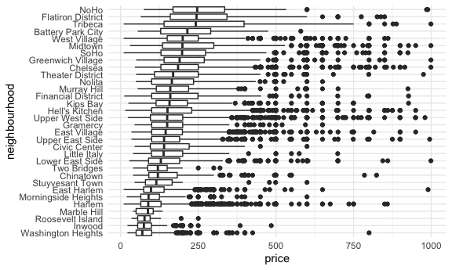
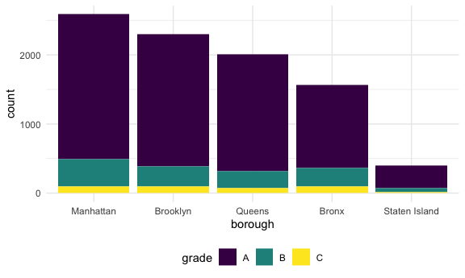

strings_and_factors
================
Emma
2026-10-20

FOR MIDTERM, MAKE PRIVATE BUT ADD THEM AS COLLABORATOR. 500 word limit
on report!

## Strings vs Factors

Both look like character vectors but:

- strings are just strings
- factors have an underlying numeric structure with character labels
  sitting on top

Factors generally make sense for variables that take on a few meaningful
values

- scales (very bad, bad, okay, good, very good)
- race
- BMI category

Strings make sense for less structured character values

Base R had some biases towards factors

## Common string operations

There are lots of things you can do with strings some are very common:

- concatenating: joining snippets into a long string
- shortening, subsetting, truncating
- changing cases
- replacing one string segment with another

All in stringr package (in tidyverse)

## Regular expressions

String operations are easy when you know what you’re looking for when
you know a general pattern but not an exact match, you need to use
regular expressions

- instead of looking for the letter “a”, you might look for any string
  that starts with a lower-case vowel

## Factors

Controlling factors is critical for several situations

- defining reference group in models
- ordering vartiables in output (tables or plots)
- introducing new factor levels

Commons factor operations

- converting characters to factors
- re leveling by hand or by count or by second variable
- renaming levels
- dropping unused levels

The forcats package to go for the majority of your factor needs

``` r
library(tidyverse)
```

    ## ── Attaching core tidyverse packages ──────────────────────── tidyverse 2.0.0 ──
    ## ✔ dplyr     1.2.1     ✔ readr     2.2.0
    ## ✔ forcats   1.0.1     ✔ stringr   1.6.0
    ## ✔ ggplot2   4.0.3     ✔ tibble    3.3.1
    ## ✔ lubridate 1.9.5     ✔ tidyr     1.3.2
    ## ✔ purrr     1.2.2     
    ## ── Conflicts ────────────────────────────────────────── tidyverse_conflicts() ──
    ## ✖ dplyr::filter() masks stats::filter()
    ## ✖ dplyr::lag()    masks stats::lag()
    ## ℹ Use the conflicted package (<http://conflicted.r-lib.org/>) to force all conflicts to become errors

``` r
library(rvest)
```

    ## 
    ## Attaching package: 'rvest'
    ## 
    ## The following object is masked from 'package:readr':
    ## 
    ##     guess_encoding

``` r
library(p8105.datasets)
```

``` r
data("starwars")
```

``` r
starwars |> 
  filter(name == "Luke Skywalker") |> 
  select(name, height, films) |> 
  unnest(films)
```

    ## # A tibble: 5 × 3
    ##   name           height films                  
    ##   <chr>           <int> <chr>                  
    ## 1 Luke Skywalker    172 A New Hope             
    ## 2 Luke Skywalker    172 The Empire Strikes Back
    ## 3 Luke Skywalker    172 Return of the Jedi     
    ## 4 Luke Skywalker    172 Revenge of the Sith    
    ## 5 Luke Skywalker    172 The Force Awakens

Unnest to see all of the different films

``` r
knitr::opts_chunk$set(
  fig.width = 6,
  fig.asp = .6,
  out.width = "90%"
)

theme_set(theme_minimal() + theme(legend.position = "bottom"))

options(
  ggplot2.continuous.colour = "viridis",
  ggplot2.continuous.fill = "viridis"
)

scale_colour_discrete = scale_colour_viridis_d
scale_fill_discrete = scale_fill_viridis_d
```

# Strings and regex

``` r
string_vec = c("my", "name", "is", "jeff")

str_detect(string_vec, "jeff")
```

    ## [1] FALSE FALSE FALSE  TRUE

``` r
str_detect(string_vec, "My")
```

    ## [1] FALSE FALSE FALSE FALSE

``` r
str_detect(string_vec, "my")
```

    ## [1]  TRUE FALSE FALSE FALSE

``` r
str_replace(string_vec, "my", "My") #replace my with My 
```

    ## [1] "My"   "name" "is"   "jeff"

detecting where in string there is a pattern match - this is case
sensitive

``` r
string_vec = c(
  "i think we all rule for participating",
  "i think i have been caught",
  "i think this will be quite fun actually",
  "it will be fun, i think"
  )

str_detect(string_vec, "i think") # finding any string with i think
```

    ## [1] TRUE TRUE TRUE TRUE

``` r
str_detect(string_vec, "^i think") # string starting with i think, ^ means line start
```

    ## [1]  TRUE  TRUE  TRUE FALSE

``` r
str_detect(string_vec, "i think$") # string that ends with i think, $ means line stop
```

    ## [1] FALSE FALSE FALSE  TRUE

``` r
string_vec = c(
  "Time for a Pumpkin Spice Latte!",
  "went to the #pumpkinpatch last weekend",
  "Pumpkin Pie is obviously the best pie",
  "SMASHING PUMPKINS -- LIVE IN CONCERT!!"
  )

str_detect(string_vec,"pumpkin")
```

    ## [1] FALSE  TRUE FALSE FALSE

``` r
str_detect(string_vec,"[Pp]umpkin") # looking for both capital or lower case p pumpkin (all caps doesn't count)
```

    ## [1]  TRUE  TRUE  TRUE FALSE

``` r
string_vec = c(
  '7th inning stretch',
  '1st half soon to begin. Texas won the toss.',
  'she is 5 feet 4 inches tall',
  '3AM - cant sleep :('
  )
# three of these follow a pattern of digit followed by two characters

str_detect(string_vec, "^[0-9][a-z]") #any digit 0 - 9 followed by lower case letter
```

    ## [1]  TRUE  TRUE FALSE FALSE

``` r
str_detect(string_vec, "^[0-9][a-zA-Z]") #any digit 0 - 9 followed by upper or lower case letter
```

    ## [1]  TRUE  TRUE FALSE  TRUE

``` r
string_vec = c(
  'Its 7:11 in the evening',
  'want to go to 7-11?',
  'my flight is AA711',
  'NetBios: scanning ip 203.167.114.66'
  )

str_detect(string_vec, "7.11") #looking for 7 and 11, separated by one character. "." matches anything
```

    ## [1]  TRUE  TRUE FALSE  TRUE

# Special characters

``` r
string_vec = c(
  'The CI is [2, 5]',
  ':-]',
  ':-[',
  'I found the answer on pages [6-7]'
  )

str_detect(string_vec, "\\[") # looking for a bracket, can't just look for [, bc that is used to define stuff. to say look for [ (which is a protected character), put \, but \ is also protected so do another \
```

    ## [1]  TRUE FALSE  TRUE  TRUE

## Quick note on factors

``` r
vec_sex = factor(c("male", "male", "female", "female")) #making character into factors 
vec_sex # not in quotes when you print. also tells you levels 
```

    ## [1] male   male   female female
    ## Levels: female male

``` r
as.numeric(vec_sex) # converts into level numbers 
```

    ## [1] 2 2 1 1

``` r
vec_sex = fct_relevel(vec_sex, "male") #telling that male is first. this changes the numeric thing hiding behind the labels, not labels themselves  
```

# examples

``` r
nsduh_url = "https://www.samhsa.gov/data/sites/default/files/NSDUHsaeShortTermCHG2015/NSDUHsaeShortTermCHG2015.htm"
```

Cleaning up the data set using string stuff:

``` r
table_marj = 
  read_html(nsduh_url) |> 
  html_table() |> 
  first() |>
  slice(-1) |> 
  select(-contains("P Value")) |>  # got rid of everything containing p value 
  pivot_longer(
    -State, # pivot everything other than State 
    names_to = "age_year", 
    values_to = "prev"
  ) |> 
  separate(age_year, into = c("age", "year"), sep = "\\(") |>  # separating this column into two new columns at the "(", have to use two backslashes to indicate not protected character here 
  mutate(
    year = str_replace(year, "\\)", ""), #replacing ) with nothing 
    prev = str_replace(prev, "[a-c]", ""), # replacing a - c with nothing
    prev = as.numeric(prev)
  )
```

In the past we used “separate” function, but here we want to split at
the parentheses

make a quick plot

``` r
table_marj |> 
  filter(age == "12-17") |> 
  mutate(State = fct_reorder(State, prev)) |> # order state according to prev, replot to make pretty
  ggplot(aes(x = State, y = prev, color = year)) +
  geom_point() +
  theme(axis.text.x = element_text(angle = 90, hjust = 1)) #hjust brings them all aligned 
```



## NYC airbnb

``` r
data(nyc_airbnb)

nyc_airbnb |> 
  filter(neighbourhood_group == "Manhattan", 
         price < 1000) |> 
  mutate(neighbourhood = fct_reorder(neighbourhood, price)) |> #order neighbourhood by price
  ggplot(aes(x = neighbourhood, y = price)) +
  geom_boxplot() +
  coord_flip() # flips x and y axes
```



## restaurant inspections

``` r
data("rest_inspec")

rest_inspec = 
    rest_inspec |> 
    rename(borough = boro)

rest_inspec |> 
  group_by(borough, grade) |> 
  summarize(n = n()) |> 
  pivot_wider(names_from = grade, values_from = n)
```

    ## `summarise()` has regrouped the output.
    ## ℹ Summaries were computed grouped by borough and grade.
    ## ℹ Output is grouped by borough.
    ## ℹ Use `summarise(.groups = "drop_last")` to silence this message.
    ## ℹ Use `summarise(.by = c(borough, grade))` for per-operation grouping
    ##   (`?dplyr::dplyr_by`) instead.

    ## # A tibble: 6 × 9
    ## # Groups:   borough [6]
    ##   borough           A     B     C  `NA`     N     P     Z     G
    ##   <chr>         <int> <int> <int> <int> <int> <int> <int> <int>
    ## 1 0                33     9     6    67    NA    NA    NA    NA
    ## 2 Bronx         14071  2611   976 17190   161   236   605    NA
    ## 3 Brooklyn      38896  6423  2194 49825   345   782  1168     2
    ## 4 Manhattan     61675  9107  3600 76581   591   924  1816     3
    ## 5 Queens        36258  5526  1996 44136   350   604  1287    NA
    ## 6 Staten Island  5410   855   248  6315    71    61   116    NA

``` r
rest_inspec =
  rest_inspec |>
  filter(grade %in% c("A", "B", "C"), borough != "Missing") |> 
  mutate(borough = str_to_title(borough))
```

``` r
rest_inspec |> 
  filter(str_detect(dba, "Pizza")) |> 
  group_by(borough, grade) |> 
  summarize(n = n()) |> 
  pivot_wider(names_from = grade, values_from = n)
```

    ## `summarise()` has regrouped the output.
    ## ℹ Summaries were computed grouped by borough and grade.
    ## ℹ Output is grouped by borough.
    ## ℹ Use `summarise(.groups = "drop_last")` to silence this message.
    ## ℹ Use `summarise(.by = c(borough, grade))` for per-operation grouping
    ##   (`?dplyr::dplyr_by`) instead.

    ## # A tibble: 4 × 3
    ## # Groups:   borough [4]
    ##   borough       A     B
    ##   <chr>     <int> <int>
    ## 1 Bronx        15     3
    ## 2 Brooklyn     15    NA
    ## 3 Manhattan    13     3
    ## 4 Queens       11     4

can’t just look for Pizza, gonna miss some stuff because of cases

This is better:

``` r
rest_inspec |> 
  filter(str_detect(dba, "[Pp][Ii][Zz][Zz][Aa]")) |> 
  group_by(borough, grade) |> 
  summarize(n = n()) |> 
  pivot_wider(
    names_from = grade, 
    values_from = n
    )
```

    ## `summarise()` has regrouped the output.
    ## ℹ Summaries were computed grouped by borough and grade.
    ## ℹ Output is grouped by borough.
    ## ℹ Use `summarise(.groups = "drop_last")` to silence this message.
    ## ℹ Use `summarise(.by = c(borough, grade))` for per-operation grouping
    ##   (`?dplyr::dplyr_by`) instead.

    ## # A tibble: 5 × 4
    ## # Groups:   borough [5]
    ##   borough           A     B     C
    ##   <chr>         <int> <int> <int>
    ## 1 Bronx          1201   261    98
    ## 2 Brooklyn       1919   291    95
    ## 3 Manhattan      2091   400    96
    ## 4 Queens         1695   239    78
    ## 5 Staten Island   328    60    15

``` r
rest_inspec |> 
  mutate(dba = str_to_upper(dba)) |> # or just make all uppercase
  filter(str_detect(dba, "PIZZA")) |> 
  group_by(borough, grade) |> 
  summarize(n = n()) |> 
  pivot_wider(
    names_from = grade, 
    values_from = n
    )
```

    ## `summarise()` has regrouped the output.
    ## ℹ Summaries were computed grouped by borough and grade.
    ## ℹ Output is grouped by borough.
    ## ℹ Use `summarise(.groups = "drop_last")` to silence this message.
    ## ℹ Use `summarise(.by = c(borough, grade))` for per-operation grouping
    ##   (`?dplyr::dplyr_by`) instead.

    ## # A tibble: 5 × 4
    ## # Groups:   borough [5]
    ##   borough           A     B     C
    ##   <chr>         <int> <int> <int>
    ## 1 Bronx          1201   261    98
    ## 2 Brooklyn       1919   291    95
    ## 3 Manhattan      2091   400    96
    ## 4 Queens         1695   239    78
    ## 5 Staten Island   328    60    15

``` r
rest_inspec |> 
  mutate(dba = str_to_upper(dba)) |> 
  filter(str_detect(dba, "PIZZA")) |>
  ggplot(aes(x = borough, fill = grade)) +
  geom_bar()
```


``` r
rest_inspec |> 
  mutate(dba = str_to_upper(dba), 
         borough = fct_infreq(borough)) |>  # put borough variable in order of how common they are
  filter(str_detect(dba, "PIZZA")) |>
  ggplot(aes(x = borough, fill = grade)) +
  geom_bar()
```



``` r
rest_inspec |> 
  mutate(dba = str_to_upper(dba), 
         borough = fct_infreq(borough), # put borough variable in order of how common they are
         borough = str_replace(borough, "Manhattan", "The City")) |> #when you do this, makes the city back into character variable, so it does not take fct infreq into account anymore 
  filter(str_detect(dba, "PIZZA")) |>
  ggplot(aes(x = borough, fill = grade)) +
  geom_bar()
```


do this instead

``` r
rest_inspec |> 
  mutate(dba = str_to_upper(dba), 
         borough = fct_infreq(borough), # put borough variable in order of how common they are
         borough = fct_recode(borough, "The City" = "Manhattan")) |> #recode as factor variable
  filter(str_detect(dba, "PIZZA")) |>
  ggplot(aes(x = borough, fill = grade)) +
  geom_bar()
```


